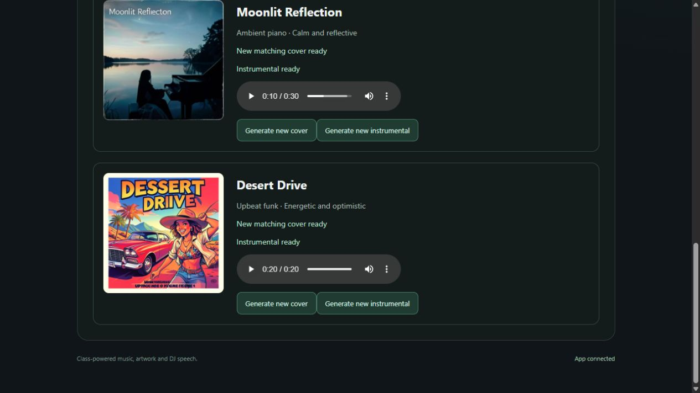

# AI Jukebox - MBAX 6418-801 (Assignment 3)

A team-built app for custom songs, matching covers and spoken DJ commentary.
**Current version: generate playable instrumental or vocal songs with AI lyrics,
each with new matching covers.** The browser creates new ACE-Step music and FLUX
artwork from a title/theme, style, mood and duration. Instrumental songs play
the music; vocal songs first write original AI lyrics with Qwen, then ACE-Step
sings them into a playable track. Everything stays paired with the correct
track across page reloads and plays inline. Registered sample songs load locally
without service settings or regeneration. The approved sample set is still pending;
DJ playback and reference uploads are not built yet.

Public repo: [AI-Jukebox_MBAX6418](https://github.com/JoshuaKosakowsky/AI-Jukebox_MBAX6418).
Team workflow is active: task branches and reviewed PRs for every change.
Live issues own assignments/status; Joshua/the team arranges access and allocations.

## Install and launch

Supported: Python 3.12-3.14 on Windows/Linux; Python 3.12 is the default selected
by .python-version. Install Python and uv once (uv can fetch Python 3.12 if needed):

```powershell
python -m pip install uv==0.12.19
```

From the repo or extracted source folder, launch:

```powershell
python scripts/dev.py
```

Open [http://127.0.0.1:8000](http://127.0.0.1:8000). The launcher installs/syncs the
exact uv.lock dependencies before starting FastAPI. No environment activation,
Node build, paid account or Git metadata is needed to launch. Internet access is
needed for the initial Python/package installation, not for subsequent empty-app
startup. On Windows the launcher automatically uses a short per-checkout directory
under LOCALAPPDATA/AI-Jukebox_MBAX6418 to avoid native-extension failures in long
OneDrive course paths. Linux uses .venv. Neither environment ships in the repo.

An early [Windows GitHub ZIP rehearsal](docs/TEST_RESULTS.md#early-windows-github-zip-startup-rehearsal---2026-10-29)
verified these startup/configuration steps without Git metadata on main `7b9dd2b`.
It does not replace the final independent full-feature ZIP check.

The app binds only to loopback. Ctrl+C stops it; if 8000 is busy, use:

```powershell
python scripts/dev.py --port 8001
```

Do not expose this development server publicly; deployment authentication is not
implemented. A wrong class endpoint produces a safe role-only terminal error;
fix .env and restart. No provider requests or generation happen on startup or on
Refresh status. Configured means values were supplied, not that a service is reachable.

## Bundled sample library

The app loads approved entries from [assets/samples/manifest.json](assets/samples/manifest.json)
at startup and adds ready tracks, covers and any vocal lyrics to each new session.
Playback needs no class-service settings. Reloading retains the session; restarting
clears generated tracks and reloads the registered samples. Manifest edits require
an app restart. Unregistered candidate files are never added automatically.

The approved manifest is currently empty, so this version opens with an empty
library. Jovi owns selection of the three final class-generated samples; see the
[record and asset requirements](assets/samples/README.md). A broken registered
asset shows a safe setup warning and leaves song creation available. This loader
and its synthetic browser rehearsal do not complete sample or ZIP acceptance.

## Configure class services

The empty app works without credentials. If .env does not already exist, copy
.env.example to .env; preserve any existing private configuration. Supply the
eight endpoint/key values from the team/class documentation. Environment variables
override .env. Missing/placeholders show Missing settings; restart after editing.
Endpoint bases can end in /v1; the clients resolve API routes from the origin.

| Role | Required class service | Port |
|---|---|---|
| Text/lyrics | Qwen3.6-35B-A3B | 9001 |
| Art | FLUX.2 klein 4B | 9006 |
| Music | ACE-Step 1.5 XL Turbo | 9007 |
| Speech | Chatterbox Multilingual V3 | 9008 |

Use the [verified provider formats](docs/SERVICE_CONTRACTS.md), not guessed APIs.
The current allowlist accepts the documented dobolyi.com host and role-specific
ports. No port 9000, paid service or fallback provider is used. Credentials remain
server-side, are ignored by Git and are excluded from browser responses, screenshots
and source archives. Never commit uploads, voice references or third-party media.

## Current browser/API behavior

1. Configure the art and text services (and music for playable tracks), launch
   normally and open the home page. Choose a mode under Design your song:
   **Instrumental** or **Vocal song with AI lyrics**.
2. Under Create an instrumental song (the heading applies to both modes), enter
   a song title/theme, musical style, mood and duration (10–60 seconds). Select
   **Create song &amp; generate instrumental** (instrumental mode) or **Create vocal
   song &amp; generate** (vocal mode). An instrumental deliberately calls FLUX once
   for a new matching cover and ACE-Step once for the audio. A vocal song calls
   FLUX for the cover and Qwen once for original lyrics; when the lyrics
   complete, the app automatically calls ACE-Step once to sing them (a lyrics
   job seen succeeding while the page is open starts the vocal-track request).
   Reloading the page never submits a new generation request and never
   continues an in-flight chain: a vocal draft whose chain was interrupted by
   a reload waits for a deliberate **Generate vocal song** click. A failed
   vocal submission is likewise a deliberate button click away.
3. Watch each track's cover/lyrics/instrumental status. Create a second distinct
   song, then reload: each track, cover, lyrics and audio remains paired with
   its own title/settings.
4. Play either song directly in the browser. After a failed or timed-out
   generation, use Resume check to continue checking the SAME class-service
   task (it never submits a new one — repeated resumes of one task stay on
   its single original submission), or Generate new instrumental / Generate
   new cover to start a fresh request deliberately. A failed replacement
   preserves existing art and audio; there are no automatic generation
   retries. If a request is uncertain, refresh before submitting again.
   While a song plays, creating another song or retrying art/music never
   interrupts it: the browser keeps the same audio element until the actual
   media reference changes. If the class service reports the music task
   itself failed, it is not endlessly resumable — Generate new instrumental
   is the only way forward.

Art and music settings are required for those controls; other services may
remain missing. With art configured but not music, the create button makes a
song draft with cover only and explains how to enable instrumentals; with
music configured but not art, the form explains that art is needed to create
tracks. Vocal mode additionally needs the text service for AI lyrics; without
it the draft/cover still creates and the form explains what to add. Refresh
status and page reload never submit generation. Lyrics appear on each vocal
track's card (a collapsible block). Instrumental songs are not available
through the vocal mode, and vocal songs are not available in the instrumental
mode — the mode is chosen at creation and kept on the track.

Session media stays in process memory, private to the browser's HttpOnly,
SameSite=Strict cookie. Reloading keeps it; restarting the app or two hours of
inactivity clears it. Limits: 20 tracks and 100 generation jobs per session,
32 sessions, two simultaneous covers and two simultaneous instrumentals, and
64 MB of media across the app. Instrumental durations are limited to 10–60
seconds so WAV downloads stay within the class service's 20 MB response cap
(60 s at 48 kHz/16-bit/stereo is about 11.5 MB).
Use a fresh private browser window for a new session if a session limit is reached.
There is no disk persistence, upload route or multi-user deployment authentication.

GET /api/session returns the v1 tracks/jobs/playback snapshot; /api/media/UUID
serves only that session's assets. POST /api/tracks creates a draft and art job;
POST /api/tracks/UUID/cover creates a replacement/retry cover job; POST
/api/tracks/UUID/lyrics (vocal tracks only) creates the Qwen lyrics job; POST
/api/tracks/UUID/music creates the instrumental or vocal music job — for vocal
tracks the track's current lyrics are submitted with the same verified ACE-Step
request, and a request without lyrics is rejected with 409. All POSTs return 202
with a queued GenerationJob; read the snapshot for the terminal result.
/api/status reports cover_generation_available, music_generation_available and
lyrics_generation_available separately from song generation; it reports
configuration, not provider reachability. See the full
[app contracts and integration notes](docs/APP_CONTRACTS.md).

The earlier [startup configuration view](results/startup-configured.jpg) shows
the app shell; live A3-02 generation evidence (exact inputs, decoded media
measurements and pairing checks) is recorded in
[docs/TEST_RESULTS.md](docs/TEST_RESULTS.md). Interactive browser screenshots
were not reproducible on this review machine; the browser flow was exercised
through the normal launcher over HTTP with fully decoded WAV/PNG media.


The screenshot is an actual normal-launch browser check, not evidence of music
generation or playback. The [empty library view](results/startup-library.jpg)
records the earlier startup-only foundation.

## Verified normal-launch milestone

On main 7cc9645, two real instrumentals (30 s ambient piano and 20 s upbeat funk)
generated with new matching covers. Actual browser checks passed play/pause/resume,
generation during playback, two-track retention and replay after reload. Joshua
confirmed that both clips were audible, instrumental and broadly matched the
requested styles. See [inputs/results](results/main-instrumental-acceptance.json).



This completes the instrumental/library and cover-pairing milestone. Vocals, the
AI DJ queue, reference voices, approved samples and ZIP/release acceptance remain.

## Development and verification

For a Git checkout, install local guards once:

```powershell
git config --local core.hooksPath .githooks
git config --local core.longpaths true
git config --local jukebox.allowPush true
python scripts/dev.py --check
```

The check command runs tracked-file safeguards, requirement coverage and all
offline tests in the locked environment. Provider tests use MockTransport; startup
tests use loopback HTTP. CI runs Python 3.12 on Windows/Linux and 3.14 on Linux.
The required aggregate check remains named test. These checks do not establish
full feature or release acceptance. Repository-only Git checks require a checkout;
the normal app also launches from source without .git.

The next feature task A3-05 implements the single playback controller and real
speech/music sequencing (A3-06 adds MP3/WAV reference voices on top of it).
Review [app contracts](docs/APP_CONTRACTS.md) before
building dependent work.

## Project guides and delivery

- [AGENTS.md](AGENTS.md), [handoff.md](handoff.md), [CONTRIBUTING.md](CONTRIBUTING.md).
- [Original assignment](docs/ASSIGNMENT.md), [PLAN](PLAN.md), [issue briefs](docs/ISSUES.md).
- [Full requirement map](docs/acceptance.json), [testing](docs/TESTING.md),
  [observed results](docs/TEST_RESULTS.md), [A2 lessons](docs/A2_LESSONS.md).
- [GitHub/protection](docs/GITHUB_SETUP.md), [completion record](docs/CONTRIBUTIONS.md).

Final delivery needs custom instrumental/vocal songs and AI lyrics, new matching
covers, a session library, track-specific spoken DJ commentary with default and
MP3/WAV reference voices, play/pause/skip and automatic sequencing without overlap.
It also needs three actual class-generated samples with provenance, progress/error
recovery, evidence/design findings and an independent exact-GitHub-ZIP installation.
See the complete brief; this paragraph does not replace it.

**Submission NOT READY.** Instrumental generation/playback and matching covers
have passed acceptance. Vocals, DJ sequencing, reference uploads, samples and
independent deployment remain incomplete. Freeze a merged main SHA, download
that GitHub ZIP and follow docs/TESTING.md with a different teammate. Submit the public repo URL,
that commit and that same ZIP on Canvas; keep it public through grading.

Adapted from [Assignment 2](https://github.com/JoshuaKosakowsky/Course-Assistant_MBAX6418)
at 1a19c33ab9929dd2796ac7a5ea53247602a0cd32; its RAG stack is not assumed here.
