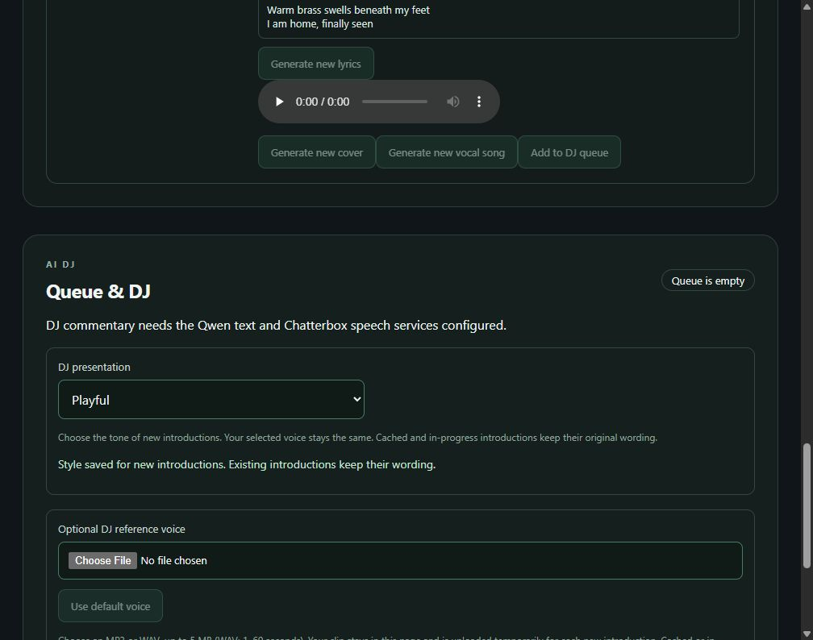
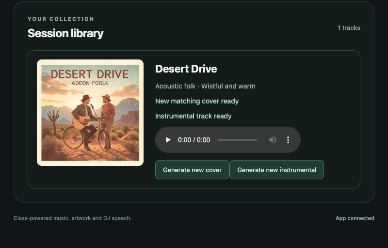

# AI Jukebox - MBAX 6418-801 (Assignment 3)

A team-built app for custom songs, matching covers and spoken DJ commentary.
**Current version: generate playable instrumental or vocal songs with AI lyrics,
each with new matching covers.** The browser creates new ACE-Step music and FLUX
artwork from a title/theme, style, mood and duration. Instrumental songs play
the music; vocal songs first write original AI lyrics with Qwen, then ACE-Step
sings them into a playable track. Everything stays paired with the correct
track across page reloads and plays inline. Registered sample songs load locally
without service settings or regeneration. Three selected samples are bundled,
including two vocal songs. Default-DJ playback has recorded real-class testing;
an optional MP3/WAV reference chooser is implemented, with its real voice
comparison still pending. The results below separate implementation from acceptance.

Public repo: [AI-Jukebox_MBAX6418](https://github.com/JoshuaKosakowsky/AI-Jukebox_MBAX6418).
Team workflow is active: task branches and reviewed PRs for every change.
Live issues own assignments/status; Joshua/the team arranges access and allocations.

## Install and launch

Supported: Python 3.12-3.14 on Windows/Linux; Python 3.12 is the default selected
by .python-version. Install Python and uv once (uv can fetch Python 3.12 if needed):

```powershell
python -m pip install uv==0.12.19
```

From the repo or extracted source folder, launch:

```powershell
python scripts/dev.py
```

Open [http://127.0.0.1:8000](http://127.0.0.1:8000). The launcher installs/syncs the
exact uv.lock dependencies before starting FastAPI. Runtime packages include
FastAPI/Uvicorn, Pydantic, HTTPX, python-dotenv, Pillow and python-multipart;
[pyproject.toml](pyproject.toml) lists dependencies and [uv.lock](uv.lock) pins them.
No environment activation,
Node build, paid account or Git metadata is needed to launch. Internet access is
needed for the initial Python/package installation, not for subsequent local sample playback. On Windows the launcher automatically uses a short per-checkout directory
under LOCALAPPDATA/AI-Jukebox_MBAX6418 to avoid native-extension failures in long
OneDrive course paths. Linux uses .venv. Neither environment ships in the repo.

An early [Windows GitHub ZIP rehearsal](docs/TEST_RESULTS.md#early-windows-github-zip-startup-rehearsal---2026-10-29)
verified these startup/configuration steps without Git metadata on main `7b9dd2b`.
It does not replace the final independent full-feature ZIP check.

The app binds only to loopback. Ctrl+C stops it; if 8000 is busy, use:

```powershell
python scripts/dev.py --port 8001
```

Do not expose this development server publicly; deployment authentication is not
implemented. A wrong class endpoint produces a safe role-only terminal error;
fix .env and restart. No provider requests or generation happen on startup or on
Refresh status. Configured means values were supplied, not that a service is reachable.

## DJ presentation

In Queue & DJ, choose **Relaxed / Public Radio**, **Upbeat Radio** or **Playful**
before starting the queue. This sets the tone of new introductions while keeping
your default or uploaded reference voice. The choice stays in this browser
session across reloads. Cached and in-progress introductions keep their original
wording; choosing a style never regenerates them or interrupts music.

## Bundled sample library

The app loads approved entries from [assets/samples/manifest.json](assets/samples/manifest.json)
at startup and adds ready tracks, covers and any vocal lyrics to each new session.
Playback needs no class-service settings. Reloading retains the session; restarting
clears generated tracks and reloads the registered samples. Manifest edits require
an app restart. Unregistered candidate files are never added automatically.

The manifest selects three Joshua-approved songs: **Afterglow Avenue** (45 s
synth-pop vocal), **Moonlit Reflection** (30 s ambient-piano instrumental) and
**Antlercover** (60 s hopeful Latin-flare vocal about an Alaskan office moose).
Original AI lyrics and matching class artwork are bundled. Mike's retained
Moonlit Rehearsal remains a possible later alternate. All three passed
[integrated-main playback/reload checks](results/a3-07-integrated-main-library.json)
on `2be9625`. Independent final GitHub ZIP acceptance remains pending. See the
[record and asset requirements](assets/samples/README.md). A broken registered
asset shows a safe setup warning and leaves song creation available. The final
ZIP check must verify the actual bundled media, not just the loader or fixtures.

## Configure class services

Local sample playback works without credentials. If .env does not already exist, copy
.env.example to .env; preserve any existing private configuration. Supply the
eight endpoint/key values from the team/class documentation. Environment variables
override .env. Missing/placeholders show Missing settings; restart after editing.
Endpoint bases can end in /v1; the clients resolve API routes from the origin.

A literal `.env` file is optional when these variables already reach the app
process. “Configured” does not prove a successful API call. For safe checks,
worktree/process pitfalls and the actual A3-03 evidence required, follow
[credentials and live acceptance](docs/TESTING.md#credentials-and-live-acceptance).

| Role | Required class service | Port |
|---|---|---|
| Text/lyrics | Qwen3.6-35B-A3B | 9001 |
| Art | FLUX.2 klein 4B | 9006 |
| Music | ACE-Step 1.5 XL Turbo | 9007 |
| Speech | Chatterbox Multilingual V3 | 9008 |

Use the [verified provider formats](docs/SERVICE_CONTRACTS.md), not guessed APIs.
The current allowlist accepts the documented dobolyi.com host and role-specific
ports. No port 9000, paid service or fallback provider is used. Credentials remain
server-side, are ignored by Git and are excluded from browser responses, screenshots
and source archives. Never commit uploads, voice references or third-party media.

## Current browser/API behavior

1. For new songs, configure art and music; add text for vocal lyrics. For DJ
   playback, configure text and speech. Bundled songs play directly without any
   service settings; Add to DJ queue needs the DJ services. Launch normally and
   choose a mode under **Design your song**:
   **Instrumental** or **Vocal song with AI lyrics**.
2. Under **Create a song**, enter
   a song title/theme, musical style, mood and duration (10–60 seconds). Select
   **Create song &amp; generate instrumental** (instrumental mode) or **Create vocal
   song &amp; generate** (vocal mode). An instrumental deliberately calls FLUX once
   for a new matching cover and ACE-Step once for the audio. A vocal song calls
   FLUX for the cover and Qwen once for original lyrics; when the lyrics
   complete, the app automatically calls ACE-Step once to sing them (a lyrics
   job seen succeeding while the page is open starts the vocal-track request).
   Reloading the page never submits a new generation request and never
   continues an in-flight chain: a vocal draft whose chain was interrupted by
   a reload waits for a deliberate **Generate vocal song** click. A failed
   vocal submission is likewise a deliberate button click away.
3. Watch each track's cover/lyrics/instrumental status. Create a second distinct
   song, then reload: each track, cover, lyrics and audio remains paired with
   its own title/settings.
4. Play either song directly in the browser. After a failed or timed-out
   generation, use Resume check to continue checking the SAME class-service
   task (it never submits a new one — repeated resumes of one task stay on
   its single original submission), or Generate new instrumental / Generate
   new cover to start a fresh request deliberately. A failed replacement
   preserves existing art and audio; there are no automatic generation
   retries. If a request is uncertain, refresh before submitting again.
   While a song plays, creating another song or retrying art/music never
   interrupts it: the browser keeps the same audio element until the actual
   media reference changes. If the class service reports the music task
   itself failed, it is not endlessly resumable — Generate new instrumental
   is the only way forward.
5. Add playable songs to the **Queue & DJ** panel and press **Play queue**: Qwen
   writes a short spoken introduction for each queued song, Chatterbox speaks
   it with the default voice or your optional MP3/WAV reference, then the music
   follows. One persistent player element drives the whole
   timeline sequentially to prevent speech/music overlap. Pause, Resume and Skip work during speech AND during
   music; the set stops cleanly after the final track. Reloading the page
   keeps the queue and position and never regenerates commentary.
   Select **Optional DJ reference voice** before playing to use your clip for
   each new introduction (up to 5 MB; WAV 1–60 seconds). **Use default voice**
   clears the choice. Cached/in-flight introductions keep their original voice;
   recordings stay temporary, are forgotten on reload and never enter saved files.
   A rejected clip does not silently fall back to the default voice. Choose another
   clip or clear it, then retry; if automatic advance stopped, press **Resume**.

Individual song players act independently when the DJ queue is idle. While the
queue is active or paused, those players are paused or prevented from starting;
use the Queue & DJ controls until the queue finishes.

Art and music settings are required for those controls; other services may
remain missing. With art configured but not music, the create button makes a
song draft with cover only and explains how to enable instrumentals; with
music configured but not art, the form explains that art is needed to create
tracks. Vocal mode additionally needs the text service for AI lyrics; without
it the draft/cover still creates and the form explains what to add. Refresh
status and page reload never submit generation. Lyrics appear on each vocal
track's card (a collapsible block). Instrumental songs are not available
through the vocal mode, and vocal songs are not available in the instrumental
mode — the mode is chosen at creation and kept on the track.

Music quality varies by style. The tested heavy metal/deathcore target is a
known limitation: it missed the requested sound in listening checks, and further
tuning is deferred for a future revisit. Other genres are being assessed as
Good to go, Minor improvement, or Major update / completely misses mark in the
[genre listening scorecard](results/README.md#genre-listening-scorecard). These
are provisional ratings of specific instrumental clips, not guarantees for
an entire genre.

Session media stays in process memory, private to the browser's HttpOnly,
SameSite=Strict cookie. Reloading keeps it; restarting the app or two hours of
inactivity clears it. Limits: 20 tracks and 100 generation jobs per session,
32 sessions, two simultaneous covers and two simultaneous instrumentals, and
64 MB of media across the app. Instrumental durations are limited to 10–60
seconds so WAV downloads stay within the class service's 20 MB response cap
(60 s at 48 kHz/16-bit/stereo is about 11.5 MB).
Use a fresh private browser window for a new session if a session limit is reached.
There is no disk persistence or multi-user deployment authentication. The only
upload route accepts temporary, session-private DJ reference audio; it has no
recording-download route and does not save recordings to disk.

GET /api/session returns the v1 tracks/jobs/playback snapshot; /api/media/UUID
serves only that session's assets. POST /api/tracks creates a draft and art job;
POST /api/tracks/UUID/cover creates a replacement/retry cover job; POST
/api/tracks/UUID/lyrics (vocal tracks only) creates the Qwen lyrics job; POST
/api/tracks/UUID/music creates the instrumental or vocal music job — for vocal
tracks the track's current lyrics are submitted with the same verified ACE-Step
request; generate lyrics before requesting vocal music (missing stored lyrics
returns 409). These generation routes return 202 with a queued GenerationJob
when accepted; read the snapshot for the terminal result.
/api/status reports cover_generation_available, music_generation_available and
lyrics_generation_available separately from song generation; it reports
configuration, not provider reachability. Temporary MP3/WAV DJ reference
uploads are accepted at POST /api/references/speech (multipart `file`; magic-
byte, size and WAV-duration validation; session memory only, consumed once, no
read route). The Queue & DJ chooser sends a fresh one-shot upload for each new
introduction, including explicit retries, and deletes unused uploads. See the full
[app contracts and integration notes](docs/APP_CONTRACTS.md).

## Verified results and current interface

The current [full interface and three-song library](results/a3-09-current-library.jpg),
[AI lyrics and local player](results/a3-09-current-lyrics.jpg), and
[DJ controls](results/a3-09-current-dj.jpg) were captured through the normal
launcher on main `fcdda54`, 2026-11-02. All four service roles were **missing**;
the screenshots show bundled media and implemented controls, not new generation
or a live reference-voice test. Generation/DJ controls correctly stay disabled
without the required services. Playful presentation persisted after reload.
See the [safe UI record](results/a3-09-current-ui.json).



Historical service tests retain their own tested commits; they were not rerun
for this documentation update. Inputs, expected behavior and observed results:

| Feature / tested source | Inputs and expected behavior | Actual result and evidence |
|---|---|---|
| Custom music, main `7cc9645` | Moonlit Reflection: ambient piano, calm, 30 s; Desert Drive: upbeat funk, optimistic, 20 s. Expect distinct playable instrumentals retained after reload. | Real ACE-Step WAVs played with pause/resume and reload retention; Joshua confirmed both broadly matched. [Live record](results/main-instrumental-acceptance.json). |
| Matching artwork, original cover test | Moonlit mountain lake / ambient piano / calm, and Desert sunrise / upbeat desert funk / warm. Expect a new FLUX cover on each corresponding draft. | Two real covers remained correctly paired after reload. Later selected samples also have class-generated covers; arbitrary lettering quality is not guaranteed. [Cover record](results/cover-browser-record.json), [sample provenance](assets/samples/README.md). |
| Default spoken DJ, main `2be9625` | Queue Afterglow Avenue, Moonlit Reflection and Antlercover. Expect Qwen commentary, Chatterbox speech, then music; pause/resume, skip and cached replay. | All three introductions succeeded (three text + three speech requests); sequential controls and cached replay/reload passed. Joshua described the first introduction as relaxed/NPR-like. [Live/browser record](results/a3-05-default-dj-live.json). |
| Packaged vocals and sample library, main `2be9625` | Approved 45 s synth-pop vocal, 30 s ambient instrumental and 60 s hopeful Latin moose-story vocal, with original AI lyrics and matching covers. Expect three ready pairs that play locally. | All three played to their ends with paired media/lyrics and reload retention; two vocal songs meet the project curation target. [Integrated-main record](results/a3-07-integrated-main-library.json). |
| Failure and recovery, main `2a19ecf` | Busy music capacity and missing music configuration. Expect safe messages and deliberate recovery without duplicate requests. | Preethi's normal-launch cases passed; exact expected/actual observations and the tested design trade-off are preserved below. [Live record](results/a3-08-normal-launch-recovery.json). |

The vocal samples establish retained class-generated audio and owner listening,
not a new normal-browser vocal-creation acceptance run. Their generation paths
and provenance are explicit in [Afterglow](results/a3-07-afterglow-generation.json)
and [Antlercover](results/a3-07-antlercover-generation.json).

### Remaining checks and known limits

- **Vocal creation (#3):** Mike reports a successful Moonlit Rehearsal run on
  `a1a41d1`; its cited acceptance files and human-listening result are still
  missing from main. Keep this separate from approved sample playback.
- **Reference voices (#6):** chooser/upload wiring and synthetic MP3/WAV tests
  are merged; the real default/MP3/WAV listening comparison remains pending
  after the earlier run stopped. No new run allowance is created here.
- **Presentation choices:** Relaxed/Public Radio, Upbeat Radio and Playful
  change the wording of new commentary. They have offline/UI checks; this is
  not a claim of different voice identities or a live comparison of all styles.
- **Quality:** specific heavier genres missed their targets, and FLUX may render
  unwanted or misspelled lettering. Existing investigated limits and curated
  cover choices remain documented; no universal quality guarantee is made.
- **Team/report/release:** a teammate still needs to verify the finished-app
  documentation/findings in their own words (R31), and independently install
  the final exact GitHub ZIP. Automated review is not another human installer.

The merged [27-case synthetic browser regression](docs/MAIN_BROWSER_REGRESSION.md)
supports recovery/control reliability on its original `25f8617` source; it does
not replace these outstanding live or release checks.

## Failure and recovery - observed results (2026-10-30)

Two real failure and recovery cases were exercised through the normal launcher
(`python scripts/dev.py --port 8010`) with the real class services and a real
browser on main `2a19ecf`. Expected vs actual:

| Case | Expected | Actual | Result |
|---|---|---|---|
| Busy music capacity | A fast burst of five 60-second instrumental submissions fills the two app-side music slots; the next music request is rejected with a safe, understandable error and no job is created | UI showed `Song draft created, but the instrumental request failed: Music generation is busy. Try again shortly.`; the rejected track kept its succeeded cover and had **no** music job; after both in-flight jobs finished, an explicit **Generate instrumental** click succeeded | PASS, live |
| Music service not configured | Launching with the music endpoint unset shows a clear configuration state and a usable path forward; the app still creates covers | UI showed `Music — Missing settings`, the button read `Create song draft & cover`, and the post-create notice explained how to enable instrumentals; a real FLUX cover still generated | PASS, live |
| Recovery from missing configuration | Restoring the music endpoint, restarting and re-creating the identical song works | Re-created track finished both cover and music jobs and played | PASS, live |

All five generated tracks decoded to five **unique** 60-second, 48 kHz stereo
WAV files with five **unique** matching 512x512 PNG covers (distinct sha256 in
the record). These are live normal-launch observations; the earlier focused
retry-control checks in docs/TEST_RESULTS.md used an offline MockTransport
harness and are labelled as offline there.

Evidence: [results/a3-08-normal-launch-recovery.json](results/a3-08-normal-launch-recovery.json),
screenshots: [failure/music not configured](results/a3-08-failure-music-not-configured.jpg),
[recovered 5-track library](results/a3-08-recovery-library.jpg),
[recovered track](results/a3-08-recovery-success.jpg).



### Tested design choice: deliberate retry, never automatic resubmission

Recovery in this app is deliberately manual. A rejected request creates no
job, so the UI restores the affected control instead of auto-retrying; **Resume
check** continues polling/downloading the SAME provider task (it never submits a
new generation), and a page reload never resubmits an in-flight or failed
request. The guarantee is per requested stage: a rejected stage is never
automatically resubmitted. One UI action may intentionally request several
stages — Create song starts a separate cover and music job, and vocal creation
also requests lyrics — so this prevents duplicate/paid work without implying a
single-request budget per action. In the 2026-10-30 live session, four music
submissions, one capacity-rejected request (which made no provider call) and
one explicit recovery submission produced five playable instrumentals; covers
were generated separately.

### Investigated limitation: capacity guard depends on explicit retry

The app allows at most two simultaneous music generations (and two covers, one
lyrics job) per running app process, with the slots shared across browser
sessions: jobs from another session can make a request in an otherwise idle
session return busy. A request arriving while both slots are occupied is
rejected with a safe 429 and requires a deliberate retry, so a very fast burst
of submissions can temporarily fail with `Music generation is busy` even though
no provider limit was hit. This is by design (no queueing, no duplicate jobs),
documented in the UI, and recoverable; the trade-off is that a rapid clicker
must retry explicitly rather than seeing queued tasks.

As of the 2026-10-30 rehearsal on main `2a19ecf`, the local offline gate
needed git >= 2.40 (Apple git 2.39.3 lacks `git hook run --to-stdin`) and a
modern Node for the optional frontend probe (the probe is skipped when Node is
absent; an installed obsolete Node can fail it — Node is not an app
requirement). CI uses the locked environment; its outcome is recorded per commit.

## Development and verification

For a Git checkout, install local guards once:

```powershell
git config --local core.hooksPath .githooks
git config --local core.longpaths true
git config --local jukebox.allowPush true
python scripts/dev.py --check
```

The check command runs tracked-file safeguards, requirement coverage and all
offline tests in the locked environment. Provider tests use MockTransport; startup
tests use loopback HTTP. CI runs Python 3.12 on Windows/Linux and 3.14 on Linux.
The required aggregate check remains named test. These checks do not establish
full feature or release acceptance. Repository-only Git checks require a checkout;
the normal app also launches from source without .git.

## Project guides and delivery

- [AGENTS.md](AGENTS.md), [handoff.md](handoff.md), [CONTRIBUTING.md](CONTRIBUTING.md).
- [Original assignment](docs/ASSIGNMENT.md), [PLAN](PLAN.md), [issue briefs](docs/ISSUES.md).
- [Full requirement map](docs/acceptance.json), [testing](docs/TESTING.md),
  [observed results](docs/TEST_RESULTS.md), [A2 lessons](docs/A2_LESSONS.md).
- [GitHub/protection](docs/GITHUB_SETUP.md), [completion record](docs/CONTRIBUTIONS.md).
- Joshua's disclosed JoshKozy reviewer (not classmates' Hermes coding agents): [setup](docs/HERMES_SETUP.md),
  [separate review-only instructions](docs/HERMES_REVIEWER.md),
  [eligibility policy](CONTRIBUTING.md#disclosed-hermes-reviewer-joshkozy).

Final delivery needs custom instrumental/vocal songs and AI lyrics, new matching
covers, a session library, spoken DJ commentary with the default voice (the
A3-05 queue is implemented; live class acceptance pending) and, later, MP3/WAV
reference voices, with play/pause/skip and automatic sequencing without overlap.
It also needs three actual class-generated samples with provenance, progress/error
recovery, evidence/design findings and an independent exact-GitHub-ZIP installation.
See the complete brief; this paragraph does not replace it.

**Submission NOT READY.** Instrumentals/covers, the three selected samples and
real default-DJ results are recorded above. Complete the published vocal-creation
and real reference-voice evidence, remaining recovery/report verification and
independent deployment. Then freeze a merged main SHA, download that exact GitHub
ZIP and follow the [submission runbook](docs/SUBMISSION_RUNBOOK.md) with a different
teammate. Submit the public repo URL, that commit and that same ZIP on Canvas;
keep the repository public through grading.

Adapted from [Assignment 2](https://github.com/JoshuaKosakowsky/Course-Assistant_MBAX6418)
at 1a19c33ab9929dd2796ac7a5ea53247602a0cd32; its RAG stack is not assumed here.
