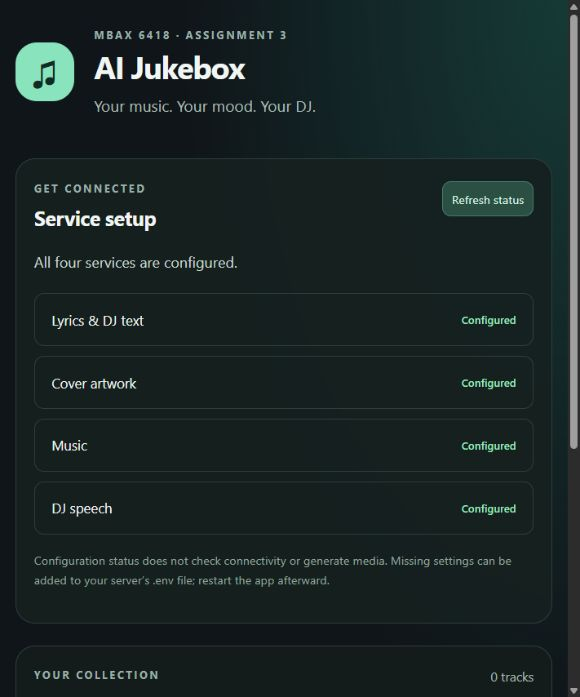

# AI Jukebox - MBAX 6418-801 (Assignment 3)

A team-built app for custom songs, matching covers and spoken DJ commentary.
**Current version: runnable startup foundation and shared contracts.** The browser
shows safe service configuration and an empty library. Generation, writable
sessions, playback, reference uploads and approved sample songs are not built yet.

Public repo: [AI-Jukebox_MBAX6418](https://github.com/JoshuaKosakowsky/AI-Jukebox_MBAX6418).
Team workflow is active: task branches and reviewed PRs for every change.
Live issues own assignments/status; Joshua/the team arranges access and allocations.

## Install and launch

Supported: Python 3.12-3.14 on Windows/Linux; Python 3.12 is the default selected
by .python-version. Install Python and uv once (uv can fetch Python 3.12 if needed):

```powershell
python -m pip install uv==0.12.19
```

From the repo or extracted source folder, launch:

```powershell
python scripts/dev.py
```

Open [http://127.0.0.1:8000](http://127.0.0.1:8000). The launcher installs/syncs the
exact uv.lock dependencies before starting FastAPI. No environment activation,
Node build, paid account or Git metadata is needed to launch. Internet access is
needed for the initial Python/package installation, not for subsequent empty-app
startup. On Windows the launcher automatically uses a short per-checkout directory
under LOCALAPPDATA/AI-Jukebox_MBAX6418 to avoid native-extension failures in long
OneDrive course paths. Linux uses .venv. Neither environment ships in the repo.

The app binds only to loopback. Ctrl+C stops it; if 8000 is busy, use:

```powershell
python scripts/dev.py --port 8001
```

Do not expose this development server publicly; deployment authentication is not
implemented. A wrong class endpoint produces a safe role-only terminal error;
fix .env and restart. No provider requests or generation happen on startup or on
Refresh status. Configured means values were supplied, not that a service is reachable.

## Configure class services

The empty app works without credentials. If .env does not already exist, copy
.env.example to .env; preserve any existing private configuration. Supply the
eight endpoint/key values from the team/class documentation. Environment variables
override .env. Missing/placeholders show Missing settings; restart after editing.
Endpoint bases can end in /v1; the clients resolve API routes from the origin.

| Role | Required class service | Port |
|---|---|---|
| Text/lyrics | Qwen3.6-35B-A3B | 9001 |
| Art | FLUX.2 klein 4B | 9006 |
| Music | ACE-Step 1.5 XL Turbo | 9007 |
| Speech | Chatterbox Multilingual V3 | 9008 |

Use the [verified provider formats](docs/SERVICE_CONTRACTS.md), not guessed APIs.
The current allowlist accepts the documented dobolyi.com host and role-specific
ports. No port 9000, paid service or fallback provider is used. Credentials remain
server-side, are ignored by Git and are excluded from browser responses, screenshots
and source archives. Never commit uploads, voice references or third-party media.

## Current browser/API behavior

- Open the home page, confirm the four configuration labels and empty session library.
- Refresh status re-reads safe local status and the empty snapshot; it does not
  validate connectivity, create tracks or contact providers.
- GET /api/health checks the app process; /api/status returns safe configuration;
  /api/session returns an empty v1 snapshot; /api/contracts and /api/openapi.json
  publish shared objects/current routes. No generation/media/upload routes exist yet.



The screenshot is an actual normal-launch browser check, not evidence of music
generation or playback. The [empty library view](results/startup-library.png)
shows the same foundation's current limits.

## Development and verification

For a Git checkout, install local guards once:

```powershell
git config --local core.hooksPath .githooks
git config --local core.longpaths true
git config --local jukebox.allowPush true
python scripts/dev.py --check
```

The check command runs tracked-file safeguards, requirement coverage and all
offline tests in the locked environment. Provider tests use MockTransport; startup
tests use loopback HTTP. CI runs Python 3.12 on Windows/Linux and 3.14 on Linux.
The required aggregate check remains named test. These checks do not establish
full feature or release acceptance. Repository-only Git checks require a checkout;
the normal app also launches from source without .git.

The next feature task A3-02 adds per-session storage, production orchestration and
a playable instrumental. A3-04 consumes the same Track/MediaRef contract for covers;
A3-05 implements the single playback controller and real speech/music sequencing.
Review [app contracts](docs/APP_CONTRACTS.md) before building dependent work.

## Project guides and delivery

- [AGENTS.md](AGENTS.md), [handoff.md](handoff.md), [CONTRIBUTING.md](CONTRIBUTING.md).
- [Original assignment](docs/ASSIGNMENT.md), [PLAN](PLAN.md), [issue briefs](docs/ISSUES.md).
- [Full requirement map](docs/acceptance.json), [testing](docs/TESTING.md),
  [observed results](docs/TEST_RESULTS.md), [A2 lessons](docs/A2_LESSONS.md).
- [GitHub/protection](docs/GITHUB_SETUP.md), [completion record](docs/CONTRIBUTIONS.md).

Final delivery needs custom instrumental/vocal songs and AI lyrics, new matching
covers, a session library, track-specific spoken DJ commentary with default and
MP3/WAV reference voices, play/pause/skip and automatic sequencing without overlap.
It also needs three actual class-generated samples with provenance, progress/error
recovery, evidence/design findings and an independent exact-GitHub-ZIP installation.
See the complete brief; this paragraph does not replace it.

**Submission NOT READY.** No generation/playback/upload feature or independent
deployment has been accepted. Freeze a merged main SHA, download that GitHub ZIP
and follow docs/TESTING.md with a different teammate. Submit the public repo URL,
that commit and that same ZIP on Canvas; keep it public through grading.

Adapted from [Assignment 2](https://github.com/JoshuaKosakowsky/Course-Assistant_MBAX6418)
at 1a19c33ab9929dd2796ac7a5ea53247602a0cd32; its RAG stack is not assumed here.
